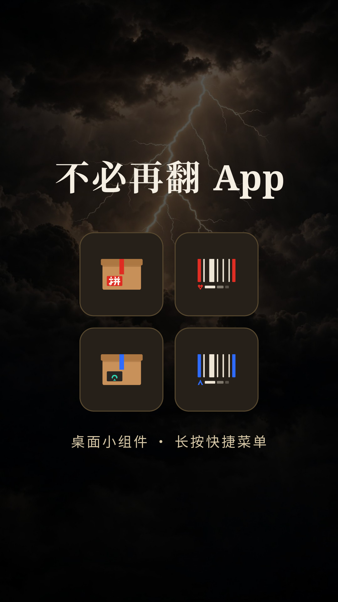
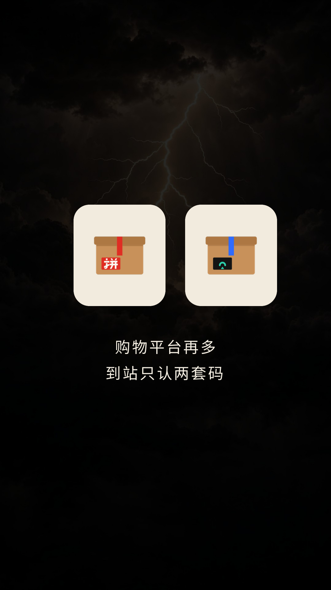
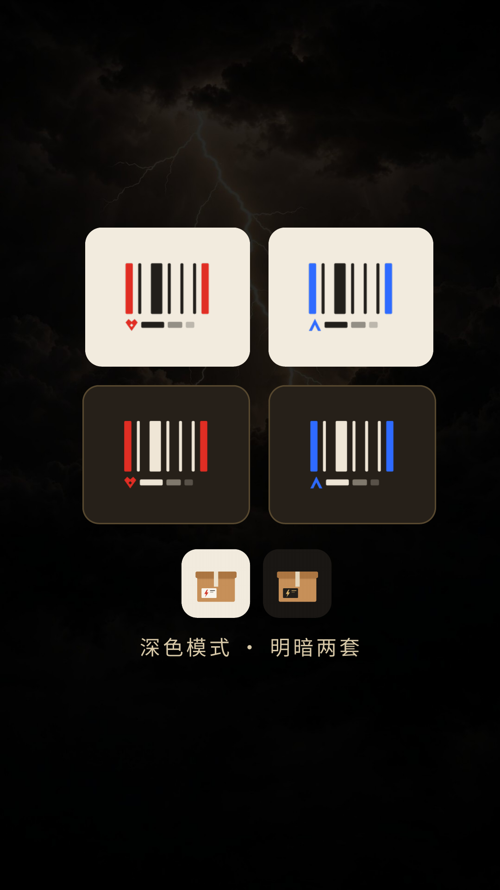
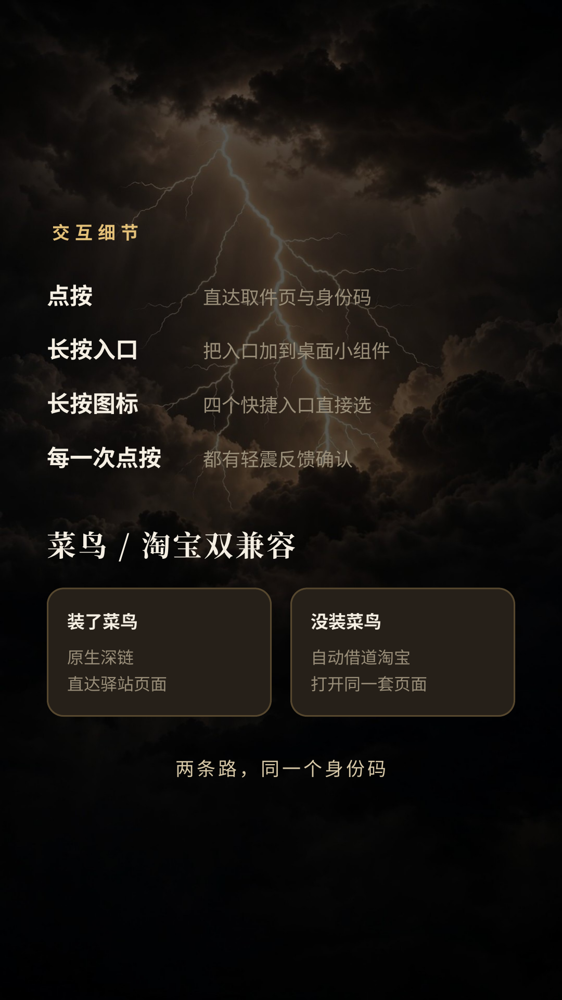

[](https://github.com/lomoho66/flash-pick)

# 闪取 FlashPick

> 驿站取件，一触即达 —— 不联网、极简轻量化的安卓小工具

[](https://github.com/lomoho66/flash-pick/stargazers)
[](https://github.com/lomoho66/flash-pick/releases)
[](LICENSE)
[](https://t.me/lom0ho)


<p>



</p>

## 这是什么

到了驿站，排着队等扫码亮灯，或是店员正问你取件码 — 而码还埋在购物 App 的三四层页面里，翻半天才找出来。

**闪取**把这一步搬到了桌面上：点一下桌面小组件（或 App 内的入口），直接打开拼多多 / 菜鸟的取件页 / 身份码页。以前约一分钟的翻找，现在一秒到位。

它不生成任何码，也不读取任何数据 —— 只是通过两个 App 对外暴露的深链，把 App 打开到对的那一页。

## 功能

- **双平台四入口** —— 拼多多、菜鸟的取件列表与身份码，一处直达
- **菜鸟 / 淘宝双兼容** —— 装了菜鸟走菜鸟；没装菜鸟、装了淘宝，也能直达淘宝里的菜鸟驿站页，不会卡在「未安装」
- **桌面小组件** —— 四个 1×1 单入口 + 一个 2×2 双入口（上下两行自选放哪两个）；1×1 与桌面图标等大同色，混排看不出是组件
- **长按图标快捷菜单** —— 长按桌面图标，四个入口直接选
- **精绘图标** —— 字标、平台签牌、圆角弧度逐一校准，浅色与深色各一套
- **明暗三档** —— 跟随系统 / 浅色 / 深色，桌面图标与组件配色随主题自动切换
- **贴心细节** —— 未装的平台自动置灰标「未安装」；点按轻震反馈；弹窗为自绘品牌风
- **极简主义** —— 少即是多：没有账号、没有信息流、没有设置迷宫，打开就是四个入口
- **干净利落** —— 无敏感权限、不联网、无广告、无内购，安装包不到 100 KB

## 为什么只有这两家？

> **少，即是快。**

购物平台再多，包裹到站只认两套身份码。

闪取只服务一个瞬间：你站在驿站里 — 店员问你取件码，或者你排着队，等扫码后货架亮灯、去找自己的包裹。

这个场景每次只需要一页：店员问码，就打开待取列表；排队扫码，就打开身份码。能把这两页直接打开的，只有菜鸟（驿站体系自己的 App，身份码就是取件凭证）和拼多多（把取件页做进了自家 App）。

淘宝、京东们的「待收货」是订单视角：看物流、确认收货、处理售后 — 那是回家慢慢翻的场景；它们也没有对外的身份码直达页，硬加进来只能跳订单列表，到了柜台前还得再翻一遍。

竞品爱做「大而全」的快递聚合，解决的是「我的包裹到哪了」；闪取解决的是「包裹就在这家驿站，把码给我」。故意只做两家、四个入口。

以前约 60 秒的翻找，现在 1 秒。

## 界面预览

| 一触即达 | 不必再翻 | 为什么快 |
|:---:|:---:|:---:|
|  |  |  |

| 零权限 | 98 KB | 只做两家 |
|:---:|:---:|:---:|
|  |  |  |

| 明暗两套 | 交互细节 | 简 · 雅 · 畅 |
|:---:|:---:|:---:|
|  |  |  |

## 下载与安装

1. 前往本仓库的 **Releases** 页下载最新版 APK，直接安装（需允许「安装未知应用」）
2. 系统要求：Android 8.0 及以上；需已安装拼多多或菜鸟 App（没装菜鸟时可用淘宝兜底）
3. 添加小组件：长按桌面空白处 →「小组件」→ 找到 **闪取**，拖到桌面即可

## 工作原理

核心是两个 App 对外暴露的深链（scheme），每条入口都备了多级兜底，保证尽量打开到对的页面：

- **拼多多** —— 深链带标签参数直达：取件页 `tab=PACKAGE` / 身份码 `tab=ID_CODE`
- **菜鸟** —— 原生深链多候选轮试（取件 / 身份码各有专属路径），全灭则拉起菜鸟本体；未装菜鸟时改走淘宝内嵌的菜鸟驿站页，再不行落网页兜底

实现见 [`Platforms.java`](app/src/com/lomoho/quickpick/Platforms.java)，跳板与震动反馈见 `JumpActivity` / `WidgetJump`。

## 从源码构建

本项目**不用 Gradle**，用一条手工打包链（aapt2 → javac → R8 → zipalign → apksigner），构建过程完全透明。

环境要求：

- JDK 17
- Android SDK：platform 34、build-tools 34.0.0

```bash
export JAVA_HOME=/path/to/jdk17
export ANDROID_HOME=/path/to/android-sdk
./build.sh
# 产物：flashpick-v1.0.0.apk
```

签名说明：本地没有签名密钥时会自动生成（`release.keystore` 与 `keystore-password.txt`，均已在 .gitignore 中排除）；官方发行版由作者自己的密钥签名。

## 项目结构

```
.
├── app/
│   ├── AndroidManifest.xml
│   ├── src/com/lomoho/quickpick/   # 全部 Java 源码（无第三方依赖）
│   └── res/                        # 布局、图标、小组件预览图等资源
├── brandpack/                      # 品牌设计资产（图标、字标源文件）
├── docs/images/                    # 介绍图
├── mappings/                       # 各发行版的 R8 mapping
├── build.sh                        # 手工打包脚本
├── CHANGELOG.md
└── LICENSE
```

## 免责声明

本项目为个人开发的学习工具，**与拼多多、菜鸟及阿里巴巴官方无关**；「拼多多」「菜鸟」「淘宝」为其权利方的商标。所用深链为相关 App 对外暴露的公开 scheme，若官方调整接口，相关功能可能失效。

## 作者

**@lomoho** —— 酷安 / GitHub 同名

如果这个小工具帮你省了时间，欢迎请作者喝杯咖啡

<a href="https://afdian.com/a/lomoho"></a>

（点击图片前往爱发电）

## 致谢

- 技术支持：Muse by Meta
- 设计支持：Claude by Anthropic

## 许可证

[GPL-3.0](LICENSE) © 2026 lomoho

## Star History

<a href="https://star-history.com/#lomoho66/flash-pick&Date">
  <picture>
    <source media="(prefers-color-scheme: dark)" srcset="https://api.star-history.com/svg?repos=lomoho66/flash-pick&type=Date&theme=dark" />
    <source media="(prefers-color-scheme: light)" srcset="https://api.star-history.com/svg?repos=lomoho66/flash-pick&type=Date" />
    
  </picture>
</a>
